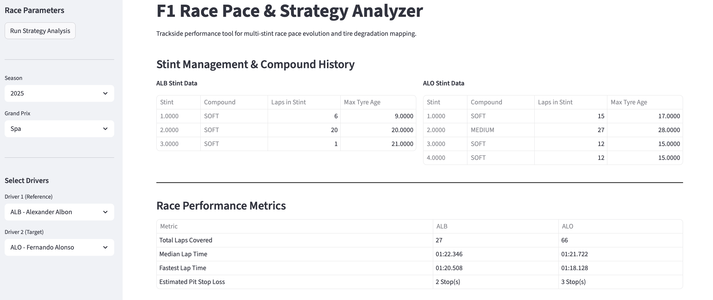
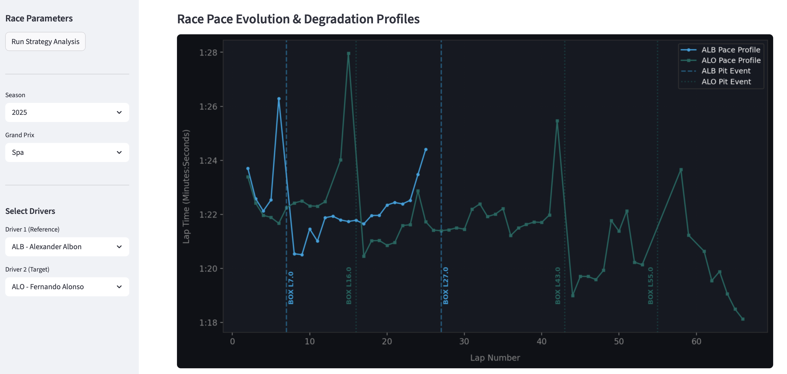

# F1 Telemetry & Strategy Dashboards

Two interactive web apps built with Python, [FastF1](https://docs.fastf1.dev) and Streamlit to analyze Formula 1 sessions: compare two drivers' laps through telemetry, and study race pace and tyre strategy.

## Apps

### 1. Telemetry comparison (`Telemetry_app.py`)

- Multi-channel comparison of two drivers' laps: speed, gear, throttle, brake, RPM and time delta
- Track dominance map built from GPS data, colored by which driver is faster in each section
- Full-screen view of the charts


### 2. Race pace & strategy analyzer (`Strategy_app.py`)

- Select a season, a Grand Prix and two drivers (reference and target)
- Stint table: tyre compound, laps per stint and tyre age
- Race metrics: laps covered, median and fastest lap time, number of pit stops
- Pace evolution chart with pit stops marked, to read tyre degradation across stints





## Tech stack

Python, FastF1, Streamlit, pandas, NumPy, Matplotlib

## Run locally

```bash
git clone https://github.com/tgenneson/f1-telemetry-dashboard.git
cd f1-telemetry-dashboard
pip install -r requirements.txt

# Telemetry comparison
streamlit run Telemetry_app.py

# Race pace & strategy analyzer
streamlit run Strategy_app.py
```

The first load of a session downloads the data through FastF1 and stores it in a local `cache_f1/` folder, so it can take a little while. Later runs are much faster.

## Disclaimer

Unofficial project, not associated with Formula 1 companies. F1, FORMULA ONE and related marks are trademarks of Formula One Licensing B.V. Data is provided by the FastF1 library.
